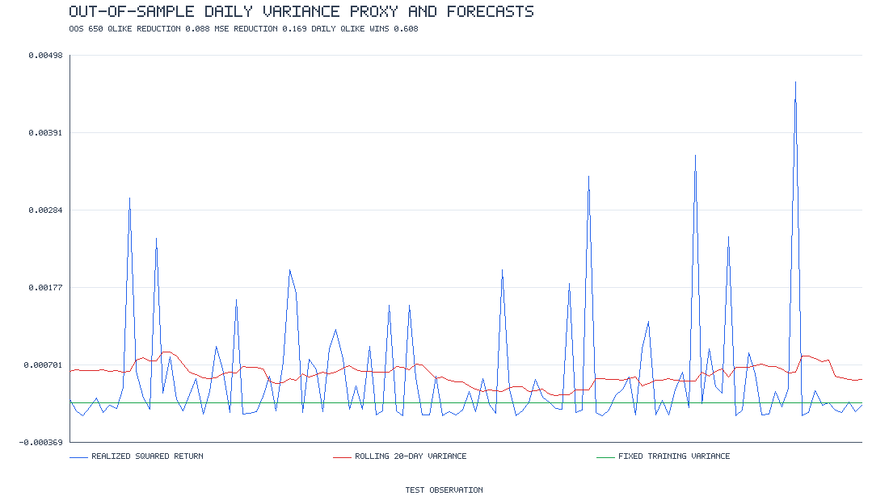
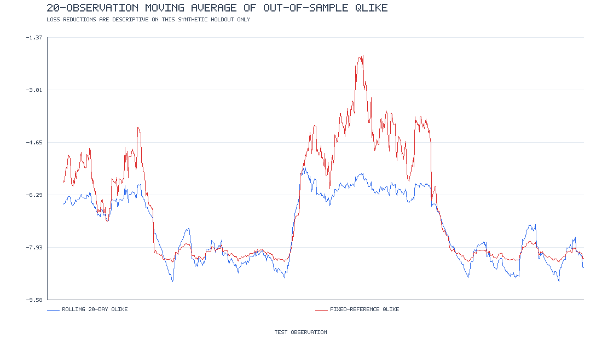

# Synthetic Volatility Forecast Comparison

A reproducible, standard-library-only comparison of two one-day variance forecasts on artificial returns. This is a teaching example, not a real-market study or evidence of investment performance.

## Run

```sh
PYTHONPATH=src /opt/homebrew/bin/python3 -m volatility_forecasting.cli
PYTHONPATH=src /opt/homebrew/bin/python3 -m unittest discover -s tests -v
```

The command reads `data/synthetic_returns.csv`, writes per-date forecasts and `forecast_summary.json` under `reports/`, and refreshes both charts in `docs/images/`. To recreate the included dataset, run `PYTHONPATH=src /opt/homebrew/bin/python3 -m volatility_forecasting.synthetic`.

## Forecast design

Returns are synthetic zero-mean Gaussian draws with fixed volatility within five deliberately artificial 180-observation blocks (see `data/dataset_metadata.json`). The first 250 returns calibrate a fixed unconditional sample-variance reference. Thereafter each forecast is made before observing the target return:

* **Rolling historical:** sample variance of the preceding 20 daily returns.
* **Reference:** the fixed sample variance of the first 250 daily returns.

The evaluation horizon is one trading day. The target `r²` is a noisy proxy for latent daily variance. The study reports average squared-return loss `(r² − h)²` and QLIKE `log(h) + r²/h` (lower is better), all in daily units. Annualized volatility is shown as `sqrt(daily variance × 252)`; losses themselves are not annualized. A small variance floor protects the logarithm and division. Synthetic block transitions are abrupt, parameters are not estimated, and squared returns are noisy, so results should not be generalized to live data.

## Metrics in the report

For each forecast, the JSON includes mean squared-return loss, mean QLIKE, mean annualized volatility, forecast bias relative to squared returns, forecast/target correlation, and the fraction of days squared returns fell below the forecast. Paired comparisons report absolute and relative loss reductions and the fraction of individual days on which rolling forecasts had lower loss. The overview PNG/SVG calls out holdout size and paired loss results. Loss improvement on this one synthetic sample is descriptive only—not evidence of forecast skill.

## Figures





White-background SVG equivalents accompany both embedded PNGs.
